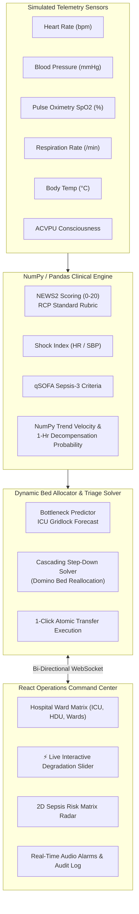

# 🏥 PULSE-TWIN: Smart Hospital Bed & Patient Deterioration Simulator

> **Operations & Clinical Digital Twin** that ingests continuous telemetry, models physiological decompensation (Royal College of Physicians **NEWS2**, **qSOFA**, **Shock Index**), and dynamically optimizes hospital bed reallocation to prevent ICU bottlenecks.

---

## 📌 The Problem
Hospital ward managers face a relentless dual challenge:
1. **Subtle Clinical Deterioration**: Sepsis and respiratory failure often develop silently over several hours before acute clinical collapse, leading to panicked emergency ICU code calls.
2. **Bed Bottlenecks & Gridlock**: When a ward patient crashes, the Intensive Care Unit (ICU) is often already operating at 100% capacity. Ward managers lack real-time decision support to triage which ICU patients are clinically stable enough to safely step down to free up life-saving critical beds.

---

## 💡 The Solution
**PULSE-TWIN** is a clinical operations twin that bridges bedside physiological telemetry with facility-wide bed logistics:
- **Clinical Decompensation Engine**: Calculates real-time **NEWS2** scores, **qSOFA** sepsis alerts, and **Shock Index ($HR / SBP$)** anomalies via **NumPy & Pandas**.
- **Dynamic Bed Reallocation Optimizer**: Automatically detects escalating patients and identifies available beds across care tiers (General Ward $\rightarrow$ HDU $\rightarrow$ ICU).
- **Cascading Step-Down Solver**: When the ICU is at 100% capacity, the algorithm identifies the most stable ICU patient (e.g., extubated, low NEWS2) and generates an atomic **domino reallocation plan** (Step down stable patient $\rightarrow$ Admit acute patient).
- **Hackathon Wow Factor — Live Interactive Degradation Slider**: An interactive slider allowing judges and clinicians to inject synthetic physiological degradation (0% to 100%) and watch live vitals crash, alarms sound, and automated bed reallocations trigger in real time.

---

## 🛠️ Tech Stack

| Layer | Technologies |
|---|---|
| **Clinical Backend** | Python 3.12, FastAPI, Uvicorn, Pydantic v2, NumPy, Pandas, Scipy, Pytest |
| **Real-Time Stream** | WebSocket Protocol (`ws://localhost:8000/ws`), Asyncio Telemetry Generator |
| **Frontend Visualizer** | React 18, Vite, Tailwind CSS, Lucide React Icons |
| **Audio Synthesis** | Web Audio API (authentic hospital telemetry alarm frequencies & chimes) |

---

## 📐 Hospital Digital Twin Architecture



---

## 🚀 Quickstart Guide

### 1. Requirements
- Python 3.10+
- Node.js 18+ and npm

### 2. One-Click Launch (Windows)
Double-click `start.bat` or run in PowerShell:
```powershell
.\start.ps1
```
This automatically launches both the FastAPI backend on `http://localhost:8000` and the Vite React frontend on `http://localhost:5173`.

### 3. Manual Launch

#### Backend:
```bash
cd backend
python run.py
```
- API Docs & Swagger UI: [http://localhost:8000/docs](http://localhost:8000/docs)
- WebSocket Endpoint: `ws://localhost:8000/ws`

#### Frontend:
```bash
cd frontend
npm install
npm run dev
```
- Frontend UI: [http://localhost:5173](http://localhost:5173)

---

## 🧪 Running Automated Unit Tests
The test suite validates the clinical scoring rubrics (NEWS2, Shock Index, qSOFA, cascading triage):
```bash
cd backend
python -m pytest tests/test_clinical_engine.py -v
```

---

## 🏆 Hackathon Presentation & Demo Script (2-Minute Walkthrough)

1. **The Ward Matrix**:
   - Point out the 4 clinical tiers: **ICU** (Pods 1-3), **HDU** (Beds 1-3), and **General Wards A & B**.
   - Note the real-time telemetry pulsing on each bed card (Heart rate, BP, SpO2, Resp, Temp, ACVPU).
   - Point out that **ICU is currently at 100% capacity** (3/3 occupied).

2. **The Hackathon Wow Factor (Interactive Degradation Slider)**:
   - Click the orange **"Degradation Slider"** button on the header or on patient **Arthur Pendelton** (Bed `WA-01`, Post-op Day 2).
   - Show Arthur's stable baseline: NEWS2 score of 0, normal blood pressure (125/78), SpO2 98%.
   - **Slide the Severity Slider from 0% to 80%** (or click the **"Silent Sepsis"** preset).
   - **Watch the Magic**:
     - Pulse spikes to 130+ bpm (tachycardia).
     - Blood pressure plummets to 82/48 mmHg (septic vasodilation).
     - SpO2 drops and respiration accelerates to 30 breaths/min.
     - **NEWS2 jumps from 0 to 18** (High Clinical Risk).
     - An authentic medical telemetry alarm chimes through the Web Audio API.

3. **The Intelligent Cascading Step-Down Solution**:
   - An immediate red banner flashes: **"AUTOMATIC BED-REALLOCATION TRIGGERED"**.
   - Explain the bottleneck: *"Arthur desperately needs an ICU bed, but the ICU is completely full!"*
   - Highlight PULSE-TWIN's AI solver:
     - **Step 1**: Identifies patient **Sarah Jenkins** in `ICU-02` who is post-cardiac arrest, successfully extubated, hemodynamically stable, and has a NEWS2 score of 0.
     - **Step 2**: Recommends stepping down Sarah from `ICU-02` to `HDU-03`.
     - **Step 3**: Reallocates the freed `ICU-02` bed to Arthur Pendelton.

4. **1-Click Execution**:
   - Click **"1-Click Execute Bed Reallocation"**.
   - Watch the ward map instantly update: Sarah moves to HDU-03, Arthur moves to ICU-02, and `WA-01` enters sanitization.
   - A success chime sounds and the audit log records the clinical transfer!

5. **Clinical Deterioration Radar**:
   - Switch to the **Deterioration Radar** tab to show the 2D Risk Matrix ($HR/SBP$ Shock Index vs NEWS2).
   - Demonstrate how occult sepsis patients are identified early before catastrophic clinical arrest.

---

## 📚 Clinical Scoring Reference

### Royal College of Physicians NEWS2 Rubric
- **Low Risk (Score 0-4)**: Ward-based response, 4–12 hourly monitoring.
- **Low-Medium Risk (Score of 3 in any single parameter)**: Urgent ward-based medical response within 30 minutes.
- **Medium Risk (Score 5-6)**: Urgent clinical review by physician or acute response team; prepare for potential step-up to HDU.
- **High Risk (Score $\ge 7$)**: Emergency assessment by critical care / ICU outreach team; urgent transfer evaluation.

### Shock Index ($SI = \frac{Heart\ Rate}{Systolic\ BP}$)
- Normal: $< 0.7$
- Borderline: $0.7 \le SI \le 0.9$
- Shock / Occult Hypoperfusion: $> 0.9$

---

## 📂 Project Structure

```
smart-hospital-bed-simulator/
├── backend/
│   ├── app/
│   │   ├── __init__.py
│   │   ├── main.py                     # FastAPI REST API & WebSocket Manager
│   │   ├── clinical_engine.py          # RCP NEWS2, qSOFA, Shock Index, NumPy anomaly engine
│   │   ├── hospital_twin.py            # Digital twin state & telemetry coordinator
│   │   ├── bed_allocator.py            # Dynamic Bed Optimization & Cascading Step-Down Solver
│   │   ├── telemetry_simulator.py      # Real-time multi-patient telemetry streamer
│   │   ├── models.py                   # Pydantic v2 schemas
│   │   └── mock_patients.py            # Clinical patient population and ward bed map
│   ├── tests/
│   │   └── test_clinical_engine.py     # Comprehensive Pytest suite
│   ├── requirements.txt
│   └── run.py                          # Python entry point
├── frontend/
│   ├── src/
│   │   ├── components/
│   │   │   ├── Navbar.jsx              # Status bar, KPIs, controls, audio toggle
│   │   │   ├── HospitalTwinWardMap.jsx # Interactive multi-tier ward map with live vitals
│   │   │   ├── DegradationSliderModal.jsx # Hackathon Wow Factor interactive slider & scenarios
│   │   │   ├── BedAllocationPanel.jsx  # Reallocation recommendations & domino solver
│   │   │   ├── PatientDetailDrawer.jsx # Deep-dive waveform graphs & NEWS2 rubric
│   │   │   ├── DeteriorationRadar.jsx  # 2D NEWS2 vs Shock Index scatter matrix
│   │   │   └── AlertsAuditLog.jsx      # Real-time alert feed & event log
│   │   ├── services/
│   │   │   ├── websocket.js            # WebSocket service with auto-reconnect
│   │   │   └── AudioAlertService.js    # Synthesized medical telemetry beeps & alarms
│   │   ├── utils/
│   │   │   └── clinicalConstants.js    # Standard thresholds and badge formatters
│   │   ├── App.jsx                     # Main application layout
│   │   └── index.css                   # Custom styles and telemetry grid
│   ├── package.json
│   └── vite.config.js
├── start.bat                           # 1-click Windows launcher
├── start.ps1                           # 1-click PowerShell launcher
└── README.md                           # Documentation & demo script
```
